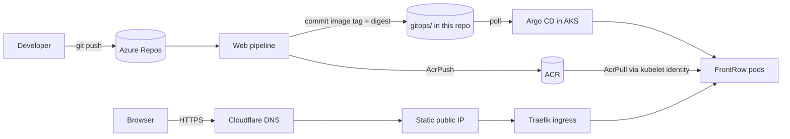

# FrontRow – Azure AKS platform (Terraform + GitOps)

Infrastructure and GitOps configuration for **FrontRow**, a React web application
served at **https://azure-fr.frontrow.co.ke** from a small, cost-optimised Azure
Kubernetes Service (AKS) lab in a single region. A second application, **CrateDigger**
(https://azure-cd.frontrow.co.ke, with a managed PostgreSQL database), runs on the same platform –
see [docs/cratedigger.md](docs/cratedigger.md).

> This platform replaces an earlier AWS/EKS deployment of the same applications.
> Nothing from the AWS stack (state, accounts, credentials) is reused.

## What it builds

| Layer | Component | Where |
|---|---|---|
| Azure foundation | Resource group, VNet/subnet/NSG, 2 static public IPs | `modules/networking` |
| Identity | 4 user-assigned managed identities + federated credentials | `modules/identity`, `environments/dev/rbac.tf` |
| Registry | Azure Container Registry (Basic, no admin user) | `modules/acr` |
| Secrets | Azure Key Vault (RBAC, purge protection, firewall) | `modules/key-vault` |
| Compute | AKS (Free tier, Azure CNI Overlay + Cilium, Entra ID + Azure RBAC, workload identity, Key Vault CSI) | `modules/aks` |
| Observability | Log Analytics (capped), Container Insights DCR, metric alerts, budget | `modules/monitoring` |
| Database (CrateDigger) | PostgreSQL Flexible Server B1ms, private access, Entra ID auth only, own Key Vault + identity | `modules/postgres`, `environments/dev/cratedigger.tf` |
| Delivery | Argo CD bootstrap, platform add-ons (Traefik, cert-manager), FrontRow Helm chart + values | `gitops/` |
| CI | Azure DevOps pipeline: fmt / validate / test / Checkov / Trivy → plan → approved apply | `azure-pipelines.yml` |



## Repository layout

```text
.
├── azure-pipelines.yml          # infrastructure CI (validate → plan → approved apply)
├── pipeline-templates/          # shared pipeline steps (pinned Terraform install)
├── .checkov.yaml / .trivyignore.yaml   # scanner config + documented exceptions
├── bootstrap/                   # one-time remote-state backend creation
├── environments/dev/            # root module for the dev lab (+ offline tests)
├── modules/                     # networking, identity, acr, key-vault, aks, monitoring
├── gitops/                      # Argo CD bootstrap, apps, platform config, Helm chart, env values
└── docs/                        # architecture, ADRs, runbooks, cost, security, learning guide
```

## Quick start

1. Read [docs/prerequisites.md](docs/prerequisites.md) (tools, Azure permissions, quotas).
2. Create the state backend: [bootstrap/README.md](bootstrap/README.md).
3. Provision: [docs/deployment-runbook.md](docs/deployment-runbook.md).
4. Bootstrap Argo CD and the platform: [docs/argocd-gitops.md](docs/argocd-gitops.md).
5. Point Cloudflare at the ingress and enable TLS: [docs/cloudflare-dns-tls.md](docs/cloudflare-dns-tls.md).

```bash
cd environments/dev
cp terraform.tfvars.example terraform.tfvars    # fill in
cp backend.hcl.example backend.hcl              # values printed by the bootstrap script
terraform init -backend-config=backend.hcl
terraform plan -out tfplan
terraform apply tfplan                           # you, deliberately - never automatic
```

## Documentation

| Topic | Document |
|---|---|
| Architecture, flows, IP plan, resource inventory | [docs/architecture.md](docs/architecture.md) |
| Architecture decision records | [docs/architecture-decisions.md](docs/architecture-decisions.md) |
| Prerequisites (Azure, Azure DevOps, tools) | [docs/prerequisites.md](docs/prerequisites.md) |
| Cost estimate and optimisation | [docs/cost-estimation.md](docs/cost-estimation.md) |
| Security controls, RBAC, secrets, accepted risks | [docs/security.md](docs/security.md) |
| Terraform concepts using this repo | [docs/terraform-learning-guide.md](docs/terraform-learning-guide.md) |
| Deployment, upgrades, operations | [docs/deployment-runbook.md](docs/deployment-runbook.md) |
| Argo CD, Helm, GitOps promotion, rollback | [docs/argocd-gitops.md](docs/argocd-gitops.md) |
| Cloudflare DNS and TLS | [docs/cloudflare-dns-tls.md](docs/cloudflare-dns-tls.md) |
| Troubleshooting | [docs/troubleshooting.md](docs/troubleshooting.md) |
| Teardown, recovery, what to keep | [docs/destroy.md](docs/destroy.md) |
| Hands-on exercises | [docs/exercises.md](docs/exercises.md) |
| Second app: CrateDigger (PostgreSQL, Entra ID auth, Key Vault secrets) | [docs/cratedigger.md](docs/cratedigger.md) |
| FrontRow API (Laravel: MySQL, Managed Redis, Blob, Communication Services Email) | [docs/frontrow-api.md](docs/frontrow-api.md) |
