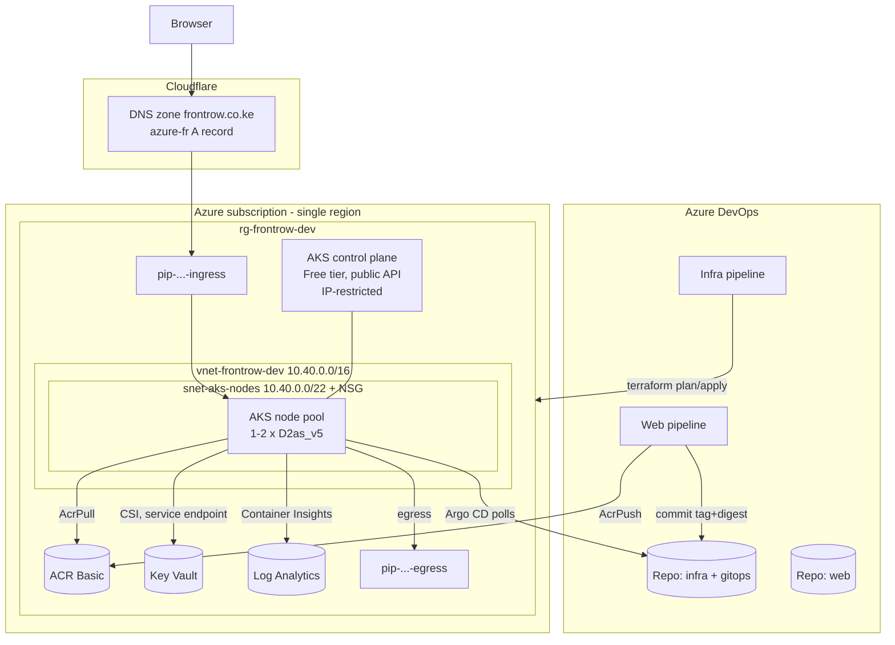
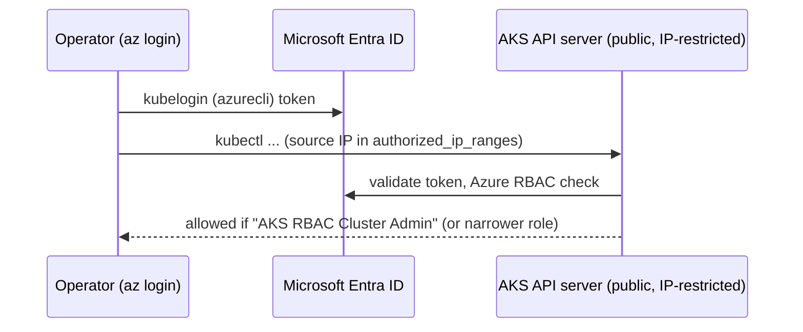
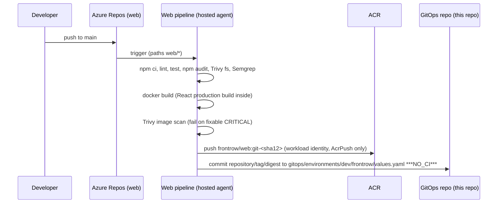
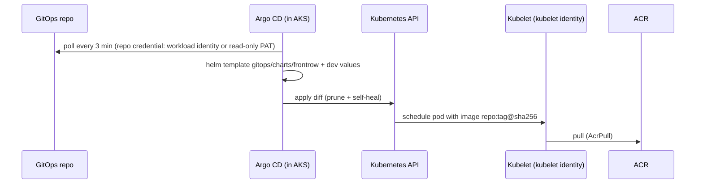
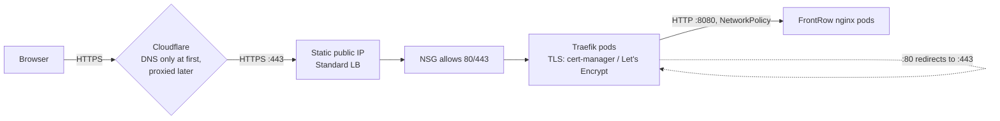
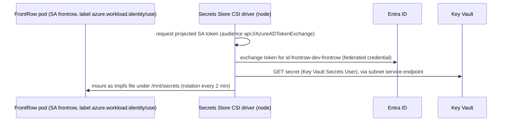

# Architecture

FrontRow is a static React single-page application. In the browser it calls external
APIs (REST backend, MQTT broker, Firebase, Auth0, Agora, Stream). Those back-end
services are **outside** this project. The Azure platform therefore only has to:
build, scan and store an image, run a handful of nginx pods, terminate HTTPS and keep
everything reproducible and cheap.

## Context

## Flows

### 1. Control plane / administration

* Local accounts are disabled, so `az aks get-credentials --admin` does not work and no
  static client certificate exists.
* Authorization uses **Azure RBAC for Kubernetes**: roles are assigned in Azure
  (`environments/dev/rbac.tf`), not via `ClusterRoleBinding`s.

### 2. CI / image publishing

### 3. GitOps reconciliation

### 4. Application traffic

### 5. Secret access (optional, Key Vault exercise)

FrontRow needs **no** runtime secrets today, so the chart ships with `keyVault.enabled: false`.

## IP plan

| Range | Purpose | Notes |
|---|---|---|
| `10.40.0.0/16` | VNet | Leaves room for future subnets; pick a range that does not overlap any network you may peer/VPN with |
| `10.40.0.0/22` | `snet-aks-nodes` | 1,019 usable IPs = node NICs only (overlay). Even 100 nodes use < 10% |
| `10.40.8.0/24` | reserved: private endpoints | Not created |
| `10.40.12.0/28` | `snet-postgres` (CrateDigger) | Delegated to PostgreSQL Flexible Server; NSG allows 5432 from the node subnet only |
| `10.40.16.0/28` | reserved: API server VNet integration / private cluster | Not created |
| `10.244.0.0/16` | Pod CIDR (overlay) | 256 nodes × /24 each; not routable in the VNet |
| `172.16.0.0/16` | Service CIDR | Cluster-internal virtual IPs |
| `172.16.0.10` | CoreDNS service IP | Must be inside the service CIDR |

Why Azure CNI **Overlay**: pods get IPs from a private overlay range, so the subnet only
needs node addresses and you avoid the classic "subnet ran out of pod IPs" failure.
Why **Cilium** data plane: eBPF-based, enforces Kubernetes `NetworkPolicy` with no extra
component or cost.

## Outbound connectivity

`outbound_type = loadBalancer` with one **Terraform-owned static egress IP**. No NAT
Gateway (hourly + per-GB charge). The node subnet has `default_outbound_access_enabled =
false`, so traffic cannot leave by any implicit path. Key Vault traffic stays on the Azure
backbone through the `Microsoft.KeyVault` service endpoint.

Egress is not filtered by destination (that requires Azure Firewall or an NVA, whose fixed
hourly charge would dominate this lab's bill). Mitigations: FrontRow pods have an egress-deny NetworkPolicy; images are scanned.

## Inbound connectivity and TLS

* `pip-frontrow-dev-ingress` (Standard, static) is attached to the Traefik `LoadBalancer`
  service through the `azure-pip-name` annotation. The address therefore survives cluster
  re-creation and can be put in Cloudflare once.
* NSG rule `allow-ingress-http-https` permits TCP 80/443 from `ingress_allowed_source_prefixes`.
* TLS: Let's Encrypt certificate issued by cert-manager (HTTP-01) and served by Traefik.
  Cloudflare SSL mode **Full (strict)** once proxying is enabled. See
  [cloudflare-dns-tls.md](cloudflare-dns-tls.md).

## Resource inventory

| Resource | Name (dev defaults) | Billing | Purpose |
|---|---|---|---|
| Resource group | `rg-frontrow-dev` | free | Lab resources |
| Node resource group | `rg-frontrow-dev-aks-nodes` | – | Managed by AKS (VMSS, NICs, LB) – never edit by hand |
| VNet / subnet / NSG | `vnet-frontrow-dev`, `snet-aks-nodes`, `nsg-frontrow-dev-aks-nodes` | free | Network |
| Public IP ×2 | `pip-frontrow-dev-ingress`, `pip-frontrow-dev-egress` | hourly | Ingress and egress addresses |
| Standard Load Balancer | `kubernetes` (node RG) | hourly + rules + data | Created by AKS |
| AKS | `aks-frontrow-dev` | control plane free; nodes hourly | Kubernetes |
| VMSS + OS disks | node RG | hourly / monthly | Nodes |
| Managed identities ×4 | `id-frontrow-dev-{aks,kubelet,frontrow,argocd}` | free | Identity |
| ACR | `acrfrontrowdev<suffix>` | daily + storage | Images |
| Key Vault | `kv-frontrow-dev-<suffix>` | per operation | Secrets |
| Log Analytics | `log-frontrow-dev` | per GB ingested beyond free allowance | Logs/insights |
| DCR | `dcr-frontrow-dev-ci` | free | Container Insights settings |
| Alerts / action group / budget | optional | metric alerts ~monthly per rule | Notifications |
| State storage | `rg-frontrow-tfstate` / `stfrontrowtfstate<suffix>` | cents | Terraform state (separate lifecycle) |
| CrateDigger: PostgreSQL, private DNS zone, Key Vault, identity, NSG | `psql-frontrow-dev-<suffix>`, `kv-cd-dev-<suffix>`, `id-frontrow-dev-cratedigger` | hourly (DB) / cents | See docs/cratedigger.md |

## In-cluster components

| Namespace | Component | Installed by | Version |
|---|---|---|---|
| `argocd` | Argo CD | `gitops/argocd/install-argocd.sh` (Helm) | chart 10.11.6 / v3.5.6 |
| `traefik` | Traefik Proxy | Argo CD | chart 42.1.3 / v3.7.16 |
| `cert-manager` | cert-manager | Argo CD | v1.21.3 |
| `frontrow` | FrontRow | Argo CD | image from ACR |
| `kube-system` | CoreDNS, Cilium, CSI drivers, Key Vault provider, metrics-server, AMA (monitoring), workload identity webhook | AKS | managed |

## What changes for production

* Private cluster (or API server VNet integration) + self-hosted agents or a VPN.
* Standard tier (uptime SLA), separate system and user node pools across availability zones,
  at least 2–3 nodes.
* ACR Premium with private endpoint, retention policy, geo-replication if multi-region.
* Key Vault and ACR private endpoints; Azure Firewall/NVA for egress filtering.
* Defender for Containers, Azure Policy with enforced baselines.
* Separate subscriptions per environment, separate state files, PR-based promotion.
* Argo CD SSO with Entra ID, notifications, HA mode.
