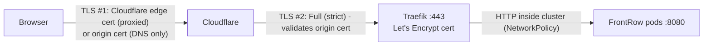

# Cloudflare DNS and TLS for azure-fr.frontrow.co.ke

Cloudflare stays authoritative for `frontrow.co.ke`. Nothing in this repository changes
Cloudflare automatically.

## End-to-end TLS



| Hop | Phase 1 (DNS only, grey cloud) | Phase 2 (proxied, orange cloud) |
|---|---|---|
| Browser → | connects directly to the Azure IP; sees the Let's Encrypt cert | connects to Cloudflare; sees Cloudflare's edge cert |
| Cloudflare → origin | n/a | HTTPS, **Full (strict)**: Cloudflare validates the Let's Encrypt cert |
| Traefik → pod | plain HTTP on the pod network, restricted by NetworkPolicy | same |

Why start with DNS only: you can test the origin certificate and Traefik without a second
layer in between, and HTTP-01 issuance is easier to reason about.

## 1. Get the ingress address (after `terraform apply`)

```bash
terraform -chdir=environments/dev output ingress_public_ip_address
terraform -chdir=environments/dev output cloudflare_dns_record
kubectl -n traefik get svc traefik -o jsonpath='{.status.loadBalancer.ingress[0].ip}{"\n"}'   # must match
```

The IP is static and owned by Terraform, so an **A record** is correct. (The IP also has an
Azure FQDN, `terraform output ingress_public_ip_fqdn`; Cloudflare allows a CNAME to it, but the
A record avoids a dependency on that label.)

## 2. Create the record

Cloudflare dashboard → `frontrow.co.ke` → DNS → Records:

| Type | Name | Content | Proxy status | TTL |
|---|---|---|---|---|
| A | `azure-fr` | *ingress_public_ip_address* | **DNS only** (grey) | Auto |

Make sure no other `A`, `AAAA` or `CNAME` record exists for `azure-fr` (a CNAME cannot coexist
with anything; a stray AAAA would send IPv6 clients elsewhere).

## 3. Issue the certificate

The FrontRow Ingress carries `cert-manager.io/cluster-issuer: letsencrypt-staging`.

```bash
kubectl -n frontrow get certificate,certificaterequest,order,challenge
kubectl -n frontrow describe certificate frontrow-tls
```

When the staging certificate is `Ready=True`, switch to production: set
`ingress.tls.clusterIssuer: letsencrypt-prod` in `gitops/environments/dev/frontrow/values.yaml`,
commit, push, then force re-issuance:

```bash
kubectl -n frontrow delete secret frontrow-tls     # cert-manager re-issues with the new issuer
kubectl -n frontrow get certificate -w
```

Renewal: cert-manager renews ~30 days before expiry (90-day certificates). Nothing to do, but
the HTTP-01 path must stay reachable (port 80 open, DNS pointing at the cluster).

## 4. Verify (DNS only phase)

```bash
dig +short azure-fr.frontrow.co.ke A            # = ingress IP
dig +short azure-fr.frontrow.co.ke AAAA         # empty
curl -sv https://azure-fr.frontrow.co.ke/healthz 2>&1 | grep -E 'subject:|issuer:|expire|HTTP/'
curl -s https://azure-fr.frontrow.co.ke/build-info.json
curl -sI http://azure-fr.frontrow.co.ke/ | head -3      # 301/308 -> https
openssl s_client -connect azure-fr.frontrow.co.ke:443 -servername azure-fr.frontrow.co.ke </dev/null 2>/dev/null \
  | openssl x509 -noout -issuer -subject -dates
```

Expected: issuer `Let's Encrypt` (R1x/E… intermediate), subject `CN=azure-fr.frontrow.co.ke`.

## 5. Enable the Cloudflare proxy (optional, recommended)

1. SSL/TLS → Overview → **Full (strict)**. (Never "Flexible": it sends plain HTTP to the origin.)
2. SSL/TLS → Edge Certificates → *Always Use HTTPS* on; *Minimum TLS* 1.2.
3. DNS → `azure-fr` → switch to **Proxied**.
4. Re-run the checks: the issuer is now Cloudflare's edge certificate.
5. Optional hardening: restrict origin access to Cloudflare. Set
   `ingress_allowed_source_prefixes` to Cloudflare's published IPv4 ranges
   (<https://www.cloudflare.com/ips-v4>) and apply. Let's Encrypt HTTP-01 renewals still work
   because Let's Encrypt reaches the origin **through** Cloudflare when proxied.
6. Real client IPs: Cloudflare sends `CF-Connecting-IP`; add Cloudflare ranges to Traefik
   `ports.websecure.forwardedHeaders.trustedIPs` if you need them in access logs.

### Alternative: Cloudflare Origin CA certificate

Cloudflare can issue a free origin certificate valid for up to 15 years. It is trusted **only
by Cloudflare**, not by browsers, so the site would show a certificate error if the proxy were
ever switched off. To use it: create it in SSL/TLS → Origin Server, store cert+key as a Kubernetes
TLS secret (`kubectl -n frontrow create secret tls frontrow-tls --cert … --key …`, never in Git),
set `ingress.tls.clusterIssuer` to empty and remove the annotation. This repo defaults to Let's
Encrypt because it works in both proxy modes.

## Troubleshooting

| Symptom | Check |
|---|---|
| `dig` returns nothing / old IP | Record name (`azure-fr`), propagation (`dig @1.1.1.1`), no conflicting record |
| Browser `NET::ERR_CERT_AUTHORITY_INVALID` | Still on `letsencrypt-staging` (expected), or Traefik's default self-signed cert because the secret doesn't exist yet |
| Certificate stuck `Ready=False` | `kubectl -n frontrow describe challenge` – common: port 80 blocked, DNS not pointing at the IP yet, Cloudflare "Always Use HTTPS" + Flexible SSL loop |
| Cloudflare 525/526 | 525: TLS handshake to origin failed (Traefik down / port 443 blocked). 526: origin cert invalid → you are on staging cert or wrong hostname; use Full (strict) only with a valid cert |
| Cloudflare 522 | Origin not reachable: NSG, Traefik service, or `ingress_allowed_source_prefixes` excludes Cloudflare |
| 404 from Traefik | Ingress host mismatch; `kubectl -n frontrow get ingress` |
| 503 from Traefik | No ready endpoints: `kubectl -n frontrow get endpoints frontrow`, pod readiness |
