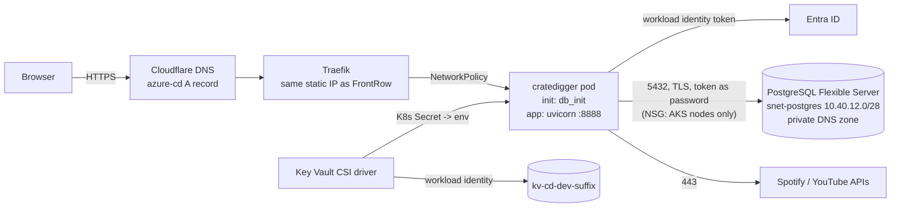

# CrateDigger on the platform

CrateDigger (`/Users/wasabi/Projects/Personal/crate-digger`) is a FastAPI app with
SQLAlchemy + Alembic. On AKS it runs as **one pod** (syncs are in-process background
tasks) against **Azure Database for PostgreSQL Flexible Server**, reached privately, with
**Microsoft Entra ID authentication only**: no database password exists anywhere.

URL: **https://azure-cd.frontrow.co.ke**, side by side with the existing nexus instance at
`cratedigger.frontrow.co.ke` (which this setup does not touch).

## How it fits together



| Piece | Where | Notes |
|---|---|---|
| Identity `id-frontrow-dev-cratedigger` | `environments/dev/cratedigger.tf` | Federated to `system:serviceaccount:cratedigger:cratedigger` |
| Key Vault `kv-cd-dev-<suffix>` | same | Separate from FrontRow's vault; identity has **Secrets User** only |
| PostgreSQL `psql-frontrow-dev-<suffix>` | `modules/postgres` | B1ms, PG 17, 32 GiB, 7-day backups, public access off, password auth off, TLS ≥ 1.2, connection logging |
| Subnet `snet-postgres` + NSG | `modules/networking` | Delegated; inbound 5432 only from `snet-aks-nodes` |
| Private DNS zone | `modules/postgres` | `<server>.private.postgres.database.azure.com`, linked to the VNet |
| Helm chart | `gitops/charts/cratedigger` | Recreate strategy, 1 replica, non-root, read-only FS, PSA restricted |
| Argo CD app | `gitops/apps/dev/cratedigger.yaml` | Project `cratedigger` (namespace-scoped) |
| Env values | `gitops/environments/dev/cratedigger/values.yaml` | image block written by the crate-digger pipeline |
| Pipeline | `crate-digger/azure-pipelines.yml` | ruff, pytest, Trivy, Semgrep, build, push, GitOps, verify |

### Database access without passwords

1. The pod carries label `azure.workload.identity/use: "true"`; the webhook injects a
   projected service-account token and `AZURE_CLIENT_ID`/`AZURE_TENANT_ID`.
2. `DATABASE_ENTRA_AUTH=true` makes the app (`app/database/session.py:enable_entra_auth`) ask
   `azure-identity` for a token for `https://ossrdbms-aad.database.windows.net/.default`
   on every **new** connection and pass it as the password (TLS required).
3. PostgreSQL validates the token: the identity is the server's **Entra administrator**
   (Terraform: `azurerm_postgresql_flexible_server_active_directory_administrator.app`).
4. The init container `python -m app.scripts.db_init` creates database `cratedigger` *as that
   identity* on first start (so it owns it – PostgreSQL 15+ only lets the owner create objects
   in `public`), then either `create_all` + `alembic stamp head` (fresh) or `alembic upgrade head`.

Trade-off: the app identity is a server admin. Acceptable for a single-app server; for a shared
server create a dedicated role (`pgaadauth_create_principal`) and drop the app from admins.

### Configuration classes

| Class | Values | Mechanism |
|---|---|---|
| Non-sensitive | `BASE_URL`, `SPOTIFY_REDIRECT_URI` (derived from `ingress.host`), `DATABASE_URL` (no password), `LOG_*`, `ENVIRONMENT` | ConfigMap / env from Helm values |
| Sensitive | `SECRET_KEY`, `ADMIN_USERNAME`, `ADMIN_PASSWORD`, `ADMIN_EMAIL`, `SPOTIFY_CLIENT_ID`, `SPOTIFY_CLIENT_SECRET`, `YOUTUBE_API_KEY` | Key Vault → CSI → synced Secret `cratedigger-secrets` → env |

## Deploy

Prerequisite: the platform runbook (deployment-runbook.md) up to Argo CD bootstrap.

### 1. Terraform

`cratedigger_enabled = true` is the default. Plan shows, in addition to the platform:
1 identity + 1 federated credential, Key Vault, 2 role assignments (+1 per operator),
delegated subnet + NSG + association, private DNS zone + link, PostgreSQL server,
4 server parameters, 1 Entra admin (+ operators).

```bash
cd environments/dev
terraform plan -out tfplan      # read it: nothing existing should change except added resources
terraform apply tfplan          # PostgreSQL creation takes ~5-10 minutes
terraform output -json cratedigger
```

Optional: make yourself a PostgreSQL Entra admin too (for `psql` troubleshooting):

```hcl
postgres_operator_admins = {
  me = { object_id = "<your object id>", principal_name = "<your UPN>", principal_type = "User" }
}
```

### 2. Secrets in Key Vault (from your allow-listed IP)

```bash
KV=$(terraform output -json cratedigger | jq -r .key_vault_name)
put() { printf '%s' "$2" > /tmp/v && az keyvault secret set --vault-name "$KV" -n "$1" --file /tmp/v -o none; rm -f /tmp/v; }
put secret-key "$(python3 -c 'import secrets; print(secrets.token_urlsafe(48))')"
read -r  -p 'admin username: ' u; put admin-username "$u"
read -rs -p 'admin password: ' p; echo; put admin-password "$p"
read -r  -p 'admin email: '    e; put admin-email "$e"
read -r  -p 'Spotify client id: ' i; put spotify-client-id "$i"
read -rs -p 'Spotify client secret: ' s; echo; put spotify-client-secret "$s"
read -rs -p 'YouTube API key: ' y; echo; put youtube-api-key "$y"
```

All seven must exist or the pod won't start (the CSI mount fails). Use the **same** admin
username as on nexus if you migrate data (step 6). Reuse the same `SECRET_KEY` as nexus only if
you want existing sessions to stay valid – a fresh one is fine.

### 3. Spotify redirect URI

Spotify developer dashboard → your app → *Redirect URIs* → add
`https://azure-cd.frontrow.co.ke/callback` (keep the nexus one).

### 4. GitOps values

Fill the `REPLACE_ME_*` values in `gitops/environments/dev/cratedigger/values.yaml` from
`terraform output -json cratedigger` and `terraform output -raw tenant_id`, then commit and push.
Argo CD picks up `gitops/apps/dev/cratedigger.yaml` through `root-dev`. If Argo CD was bootstrapped
before this change, re-apply the projects once: `kubectl apply -n argocd -f gitops/argocd/projects.yaml`.

### 5. First image

Create the pipeline from `crate-digger/azure-pipelines.yml`, variable group
`frontrow-cratedigger-dev` (`ACR_NAME`, `GITOPS_REPO_URL`, `APP_FQDN=azure-cd.frontrow.co.ke`,
`VERIFY_DEPLOYMENT=false` at first), authorise `sc-frontrow-acr-push`. Run it on `main`.

```bash
kubectl -n argocd get app cratedigger-dev
kubectl -n cratedigger get pods,secret,ingress,certificate
kubectl -n cratedigger logs deploy/cratedigger -c db-init     # database.created / initialising / ready
```

### 6. DNS and TLS

Same ingress IP as FrontRow. Cloudflare → DNS → add `A azure-cd → <terraform output
ingress_public_ip_address>`, **DNS only** first. Follow cloudflare-dns-tls.md (staging issuer →
prod issuer). Then set `VERIFY_DEPLOYMENT=true`.

### 7. Moving your nexus data (optional, when ready)

The script copies everything (users, crates, tracks, matches, sets, stored Spotify tokens) into
the Azure database in one transaction and verifies row counts. Nexus is only read from.

```bash
# On nexus: consistent copy of the live SQLite file (online backup, no downtime)
sqlite3 /path/to/data/cratedigger.db ".backup '/tmp/cratedigger-$(date +%F).db'"
# Copy it to your workstation (scp over the tunnel), then into the cluster:
POD=$(kubectl -n cratedigger get pod -l app.kubernetes.io/name=cratedigger -o name | head -1)
kubectl -n cratedigger cp ./cratedigger-YYYY-MM-DD.db "${POD#pod/}":/tmp/source.db -c app

# Bring the SQLite copy to the code's Alembic head if it is older (works on the copy in /tmp):
kubectl -n cratedigger exec "$POD" -c app -- sh -c \
  'DATABASE_URL=sqlite:////tmp/source.db DATABASE_ENTRA_AUTH=false python -m alembic upgrade head'

# Dry run (prints row counts and revisions), then copy:
kubectl -n cratedigger exec "$POD" -c app -- python -m app.scripts.sqlite_to_postgres /tmp/source.db
kubectl -n cratedigger exec "$POD" -c app -- python -m app.scripts.sqlite_to_postgres /tmp/source.db --replace
kubectl -n cratedigger exec "$POD" -c app -- rm /tmp/source.db
kubectl -n cratedigger rollout restart deploy/cratedigger
```

If the dry run reports `source revision: None`, the nexus database was created by `create_all`
and never stamped. Don't run `upgrade` on it blindly (the first migration would try to add
things that may already exist): check which migrations' changes are present
(`sqlite3 source.db .schema`), `alembic stamp <that revision>` on the copy, then `upgrade head`.

`--replace` empties the Azure tables first (they only hold the seed rows from the first start).
The pod's `/tmp` is a memory-backed emptyDir (128 MiB limit) and vanishes with the pod – keep the
backup file somewhere safe and delete it when done (it contains your Spotify tokens and the
password hash). Tested locally against PostgreSQL 17 with all 17 tables populated: 702 rows
copied, counts verified, identity sequences moved past the copied ids.

Cut-over of `cratedigger.frontrow.co.ke` later = migrate again shortly before, then change that
Cloudflare record from the tunnel to the ingress IP and add `cratedigger.frontrow.co.ke` to the
ingress (`ingress.host`). Mind the warning in crate-digger's `deploy/cloudflared-config.yml`:
the nexus tunnel also carries SSH.

## Operations

| Task | How |
|---|---|
| Logs | `kubectl -n cratedigger logs deploy/cratedigger -c app -f` (JSON); Log Analytics `ContainerLogV2 \| where PodNamespace == "cratedigger"` |
| Rotate a secret | update it in Key Vault → within ~2 min the synced Secret changes → `kubectl -n cratedigger rollout restart deploy/cratedigger` (env vars are read at start) |
| Rollback | `git revert` the `cratedigger-dev: deploy …` commit in the infra repo. Schema migrations are **not** rolled back automatically; a release that ran a migration may need `alembic downgrade` first |
| Backups | automatic, 7 days, point-in-time restore: `az postgres flexible-server restore -g rg-frontrow-dev --source-server psql-frontrow-dev-<suffix> -n psql-frontrow-dev-<suffix>-restore --restore-time <UTC>` (creates a new server) |
| Stop costs | `az postgres flexible-server stop …` (compute stops for up to 7 days, storage still bills, Azure restarts it automatically after 7 days); `cratedigger_enabled = false` + apply destroys it – **back up first** (`pg_dump` from a pod) |
| psql as yourself | add yourself to `postgres_operator_admins`; from a pod: `kubectl run psql --rm -it -n cratedigger --image=postgres:17-alpine -- psql "host=<fqdn> dbname=cratedigger user=<UPN> sslmode=require"` with `PGPASSWORD=$(az account get-access-token --resource-type oss-rdbms -q accessToken -o tsv)` (PSA restricted may require a securityContext override) |

## Troubleshooting

| Symptom | Check |
|---|---|
| Pod `ContainerCreating`, event `MountVolume.SetUp failed … secrets-store` | A Key Vault secret is missing, wrong vault name, or the identity lacks Secrets User; `kubectl -n cratedigger describe pod` |
| `CreateContainerConfigError: secret "cratedigger-secrets" not found` | Transient while the CSI driver creates it on first mount; persists only if the mount fails (above) |
| db-init: `password authentication failed` / `FATAL: Azure AD access token not valid` | Wrong user name in `DATABASE_URL` (must be the identity **name** `id-frontrow-dev-cratedigger`), Entra admin not yet created, or token audience wrong |
| db-init: `could not translate host name` | Private DNS zone not linked, or a typo in the FQDN; test from a pod: `getent hosts <fqdn>` |
| db-init: connection timeout | NSG on `snet-postgres`, NetworkPolicy egress (`postgresCidr`), server stopped |
| db-init exits 1 `database.unmanaged_schema` | Tables exist without `alembic_version` (someone created them by hand); verify, then `alembic stamp head` |
| Spotify login `INVALID_CLIENT: Invalid redirect URI` | Step 3 |
| Pod restarts during a long sync | Liveness probe (90 s tolerance) – check memory (`limits.memory: 512Mi`) |

## Cost (northeurope, Retail Prices API, 2026-10-30)

| Item | Unit price | Monthly |
|---|---|---|
| PostgreSQL Flexible Server B1ms compute | $0.018 / h | ≈ $13.14 |
| Storage 32 GiB | not returned by the API query used – check the calculator | a few $ |
| Backup storage | free up to 100% of provisioned storage; then $0.095 / GB-month (LRS) | $0 typical |
| Private DNS zone | not queried (historically ~$0.50/zone) | < $1 |
| Key Vault, NSG, identity | operations only / free | ≈ $0 |
| Pod on the existing node | requests 50m CPU / 192 MiB | $0 extra unless it forces the autoscaler to add a node |

## App changes made for this deployment

All opt-in; local SQLite / docker-compose use is unchanged. 96 tests pass (91 before + 5 new).

| File | Change |
|---|---|
| `requirements.txt` | `psycopg[binary]` enabled, `azure-identity` added |
| `app/config.py` | `database_entra_auth`, `database_entra_scope`, `app_version` |
| `app/database/session.py`, `migrations/env.py` | Entra token hook (`enable_entra_auth`); Alembic keeps app loggers |
| `app/scripts/db_init.py` | create DB → create_all + stamp / upgrade (idempotent) |
| `app/scripts/sqlite_to_postgres.py` | verified SQLite → PostgreSQL copy |
| `app/routes/web/pages.py` | `/healthz` adds `X-App-Version` header (body unchanged) |
| `Dockerfile` | pinned `python:3.13.17-slim-trixie`, `apt-get upgrade`, no curl/pip/setuptools at runtime, `GIT_SHA` → `APP_VERSION` |
| `.dockerignore` (new) | **previously missing**: images built before this included `.env` (real secrets) and `.venv` |
| `docker-compose.yml` | healthcheck without curl |
| `azure-pipelines.yml` (new) | CI/CD |
| `tests/test_database_init.py`, `tests/test_api.py` | 5 new tests |

**Action:** any image previously built from crate-digger with `docker build`/`compose` contains
your `.env`. If such an image was ever pushed to a registry, rotate those secrets (Spotify client
secret, YouTube key, admin password, `SECRET_KEY`).
